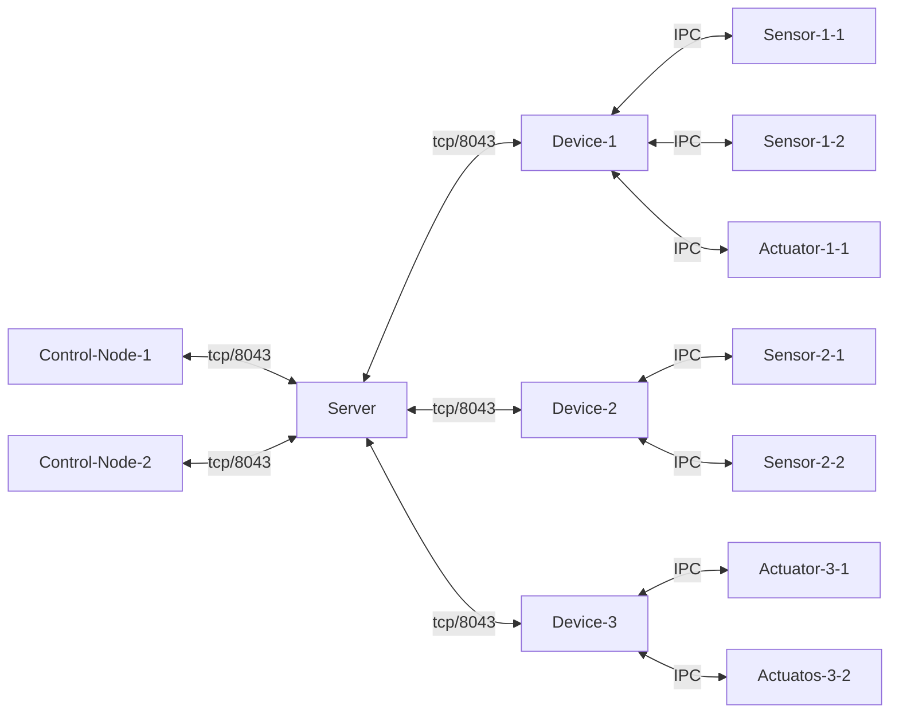
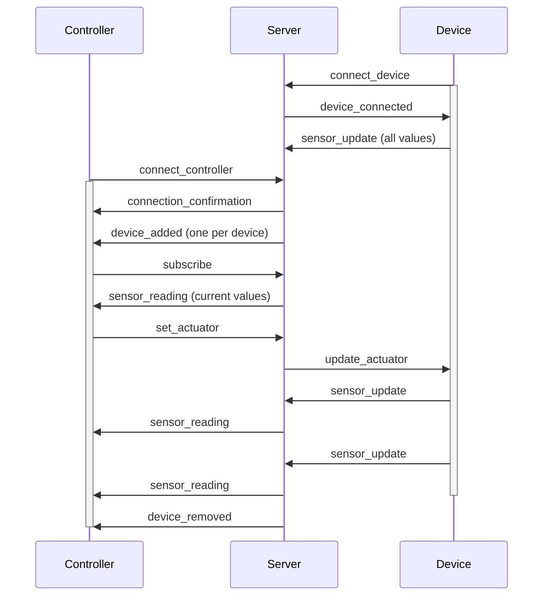
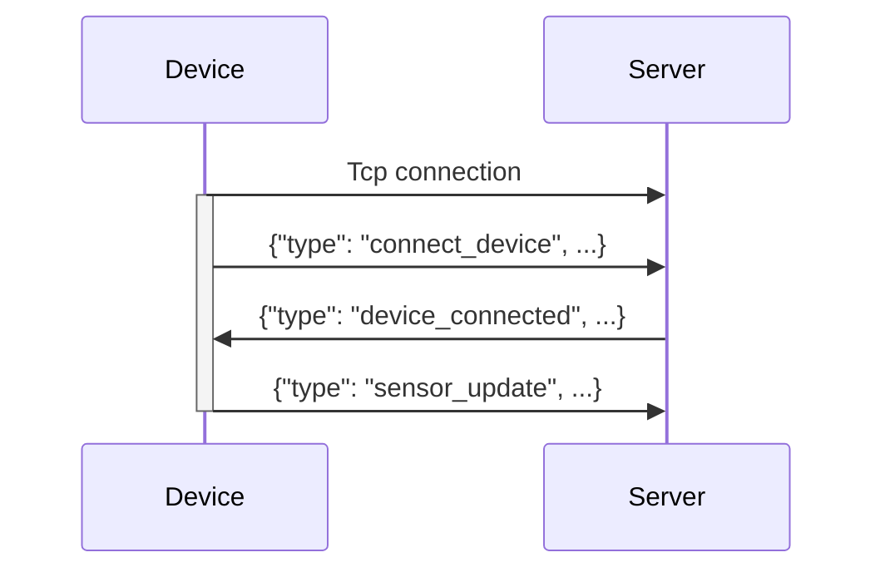
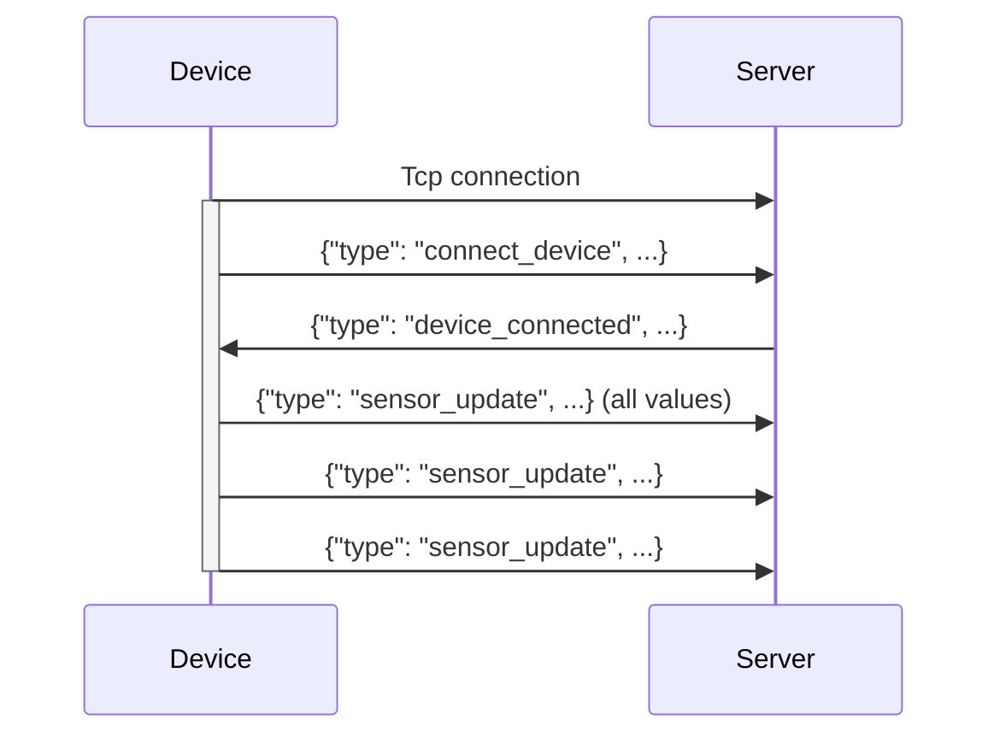
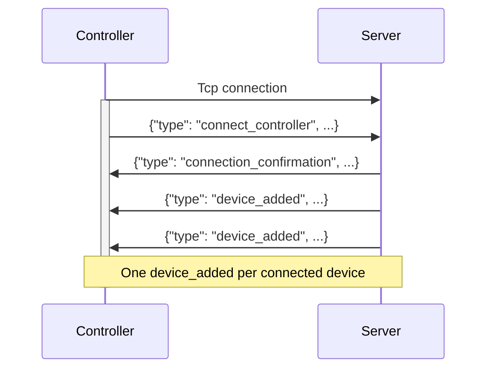
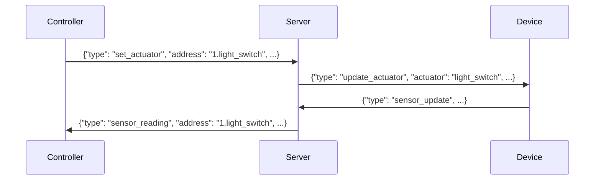

# Protocol

This document describes the binary protocol for the <TODO> smart home system.

## Terminology
| Term | Definition                                                                                                                                   |
| :---: |:---------------------------------------------------------------------------------------------------------------------------------------------|
| length-prefixed | A encoding scheme where the length of a payload is sent before the payload itself, allowing readers to pre-allocate buffers.                 |
| big-endian | A byte encoding where the most significant byte comes first, matches most intuitions, <https://en.wikipedia.org/wiki/Endianness>             |
| json | A common plaintext structured format, thats self describing and supported by a wide range of languages, <https://en.wikipedia.org/wiki/JSON> |
| tcp | A low level transport-layer protocol that provides reliability and ordering, <https://en.wikipedia.org/wiki/TCP>                             | 
| UTF-8 | The most common text encoding that handles all of unicode, and widely supported. <https://en.wikipedia.org/wiki/UTF-8>                       |
| Node | A client in the network, either an iot device or a controller.                                                                               |
| Server | The central server/brooker                                                                                                                   |
| Controller | A controller-node that connects to the central server in order to issue commands and view the status of the network                          |
| Device | A Physical iot device, acts as one network client/node, may contain multiple local sensors/acctutors                                         |


## Payloads and connections

### Connection
We use a persistent TCP connection to a central server on port `8043`.

All clients, control-nodes and sensor-nodes, will connect to the central server which will act as a broker as described later on. Each device will then be responsible for multiple sensors/actuators.


> [!NOTE]
> communication between devices and its onboard sensors/actuators are outside the scope of this specification, as long as the device exposes the required addressing capabilities which will be described later on in this document.

### Packets

The core message format is length-prefixed json.
Specifically each packet start with 8 bytes (64 bits) in big-endian encoding a length `n`, the next `n` bytes are the json payload encoded as utf-8.

For example the payload `{"value": 20}` would be sent as (in hexadecimal) `000000000000000d7b2276616c7565223a2032307d`, where:
```
000000000000000d            - 13
7b2276616c7565223a2032307d  - {"value": 20}
```

### Communication model / message flow
For devices we will use a push based model in both directions (device pushes sensor updates to the server, and the server pushes actuator commands to the device),
For the controller to server we will use primarly pull based, with the option for the controller to subscribe to push based updates for certain sensors.

The diagram below provides a high level overview of the nominal flow of the protocol, which will be laid out in more detail below.



## Payload structure

All payloads have a root level `type` key, which indicates the kind of command/message it is. 
In addition each message will contain a `request_id`, if the message is a request this will be a new id minted by the client, any responses to that request will have their `request_id` field set to the same value. The packest that the server pushes on its own have a request_id = null. 

> [!WARNING]
> It is the clients responsibility to ensure request ids are unique for that connection, if requests ids are re-used the server behaviour is undefined. 

### Addressing 
Devices get allocated an id upon connection, and the sensors/actuators underneath it have a string address which should be descriptive of their function, for example "temp". The global sensor/actuators addresses are then `{device_id}.{local_id}`. For example a device with id `3`, with a sensor at id `temp` would be addressed as `3.temp`. The namespace on a device is shared, so an actuator and a sensor on the same device cannot have the same local id.

The exact allocation and format of ids is up to the server and individual devices, the only restriction is that the ids must not contain a `.`.

Device ids are allocated by the server based on the `uuid` each device sends in its `connect_device` payload (see [Device connection flow](#device-connection-flow)). A device reconnecting with the same `uuid` gets the same device id back, so its global sensor addresses stay stable across reconnects. The server persists the mapping to a file (device_ids.json), so device ids survive a server restart. This is so that automation rules and controllers reffering to specific device ids would work properly after a restart.

### Error handling

In the event of a processing error the server will respond with a `error` payload, containing a `msg` field, and a *optional* `request_id` field (if the server fails to read the json completely it will not include the request id).

```json
{
    "type": "error",
    "request_id": "...",
    "msg": "Expected field ...."
}
```

### Capabilities configuration
A capability is a sensor or an actuator. Which is which is determined by the type. A capability does not know about its own id. The id is the key its under in connect_device.

A sensor is a abstract source of values attached to a specific device, devices and the server use the following structure to define sensors:
```jsonc
{
    // Always "sensor" for sensors
    "type": "sensor",
    // A  user facing name for the sensor, this is allowed to be non-unique
    "name": "Temprature",
    // The kind of sensor in an abstract sense, see table below
    "sensor_type": "numeric"
}
```
An actuator is an abstract representation of something on a device that can be set and that can act based on given parameters. Like the sensor, actuators are attached to devices, and like the sensors, its current state is udpated in sensor_update. The server uses the following structure to define actuators:
```jsonc
{
    // Always "actuator" for actuators
    "type": "actuator",
    // A  user facing name for the actuator, this is allowed to be non-unique
    "name": "Temperature Control",
    // The kind of actuator in an abstract sense, see table below
    "actuator_type": "numeric"
}
```

| Type | Sensor|Actuator|
| --- | --- |---|
| `numeric` | A sensor providing numeric data, such as temprature, humidity, etc. | Takes a number, for example temperature.|
| `binary` | A binary sensor provides a true/false reading, often representing the on/off state of a device, or for example wether a motion sensor is detecting motion. | Takes true or false, for example a light switch.|


## Devices

A device is a physical cluster of sensors and actuators. 

### Device connection flow

On connection the device will send a `connect_device` payload containing a persistent `uuid`, user facing metadata such as names, as well as its sensors/actuators.

The `uuid` identifies the physical device. A device must generate it once (for example with `uuid4()`) and reuse the same value every time it connects, typically by storing it. Generating a new `uuid` on every start makes the server treat the device as a new device each time.
```jsonc
{
    "type": "connect_device",
    "request_id": "1",
    "uuid": "3f2a8c1e-9b4d-4e7a-a1c2-7d9e0f5b6a3c",
    "name": "IKEA ...",
    // A mapping from local addresses to capabilities (as defined above)
    "capabilities": {
        "temperature": {
            "type": "sensor",
            "name": "Temperature",
            "sensor_type": "numeric"
        },
        "fire": {
            "type": "sensor",
            "name": "Is on fire",
            "sensor_type": "binary"
        },
        "light_switch": {
            "type": "actuator",
            "name": "Ceiling light",
            "actuator_type": "binary"
        },
        "temperature_control": {
            "type": "actuator",
            "name": "Target temperature",
            "actuator_type":"numeric"
        }
    } 
}
```

If the server allocates this device for example the id `1`, then the global address of the sensors and actuators are "1.temperature", "1.fire","1.light_switch" and "1.temperature_control" respectively. To add a new capability or remove an old one, the device needs to reconnect.

The server answers a connect_device with an ACK styled device_connected reply. It carries the request_id of the connect_device message and it tells the device the device_id it was given.
```jsonc
{
    "type":"device_connected",
    "request_id":"1",
    "device_id": 1
}
```
The device must wait for the device_connected message before sending any other packets. 



### Capability updates

Devices push updates to the server on their own schedule, its up to each device if it wants to send updates at a fixed time interval or when it detects changes.
Each update consists of a mapping of local addresses to the sensors new values or the actuators new states, unchanged sensors or actuators are allowed to be ommited. If it does not recieve an update to a specific value, the server holds the old value.

After receiving the device_connected reply, the device must send the server the values for all of its capabilities in the first sensor_update it sends. 

```jsonc
{
    "type": "sensor_update",
    "request_id": null,
    "sensors": {
        "temperature": 22,
        "fire": false,
        "light_switch": true,
        "temperature_control":22
    }
}
```

Then on future updates unchanged sensors can be left out.

```jsonc
{
    "type": "sensor_update",
    "request_id": null,
    "sensors": {
        "temperature": 21,
        "light_switch": false
    }
}
```



### Actuator commands

When a controller changes the behaviour of an actuator, the server relays that to the device in the form of an update_actuator.

```jsonc
{
    "type": "update_actuator",
    "request_id": null,
    "actuator": "light_switch",
    "value": false
}
```

The device then applies the value and reports the new state back as a sensor_update. If, for whatever reason, the value could not be fully applied, it reports the actual sate back. "actuator" is the local id as the device sees it. 


## Controllers

Controllers are how users interact with a system. A controller sends requests to the server to set actuators or to subscribe to updates, and server sends out readings from sensors and actuator states.  

### Controller connection flow

On connection a controller will send a connect_controller message with a role, if the role is left out it defaults to "user".

```jsonc
{
    "type":"connect_controller",
    "request_id":"2",
    //user or technician
    "role":"user"
}
```
There is no login, the server trusts the declared role. For now, user and technician have no different permissions. Technician will eventually be able to do maintenance, such as removing the hardware id to device id pairings in the device_ids.json file

The server replies to connect_controller with a connection_confirmation. 

```jsonc
{
    "type":"connection_confirmation",
    "request_id":"2"
}
```

Right after the confirmation, server starts sending device_added for every device thats already connected and their capabilities latest values. Look at [Device list updates](#device-list-updates) for more details.



### Device list updates

The device_added packet contains all the information about a device that the controller needs to know about. One device_added is sent per device upon connection, as described above. A device_added is also sent to all controllers when a device connects, even if it is a reconnect. 

```jsonc
{
    "type": "device_added",
    "request_id": null,
    "device": {
        "device_id": 1,
        "name": "IKEA",
        "capabilities": {
            "temperature": {
                "type": "sensor",
                "name": "Temperature",
                "sensor_type": "numeric"
            },
            "fire": {
                "type": "sensor",
                "name": "Is on fire",
                "sensor_type": "binary"
            },
            "light_switch": {
                "type": "actuator",
                "name": "Ceiling light",
                "actuator_type": "binary"
            },
            "temperature_control": {
                "type": "actuator",
                "name": "Target temperature",
                "actuator_type": "numeric"
            }
        },
        "values": {
            "temperature": 22,
            "fire": false,
            "light_switch": true,
            "temperature_control": 22
        }
    }
}
```

### Device removed

Sent whenever the devices connection ends. 

```jsonc
{
    "type": "device_removed",
    "request_id": null,
    "device_id": 1
}
```

If a controller somehow recieves a device_added for a device it already knows, the new information replaces the old. 

### Subscribing to values

A controller only receives live updates for the addresses it subscribes to.

```jsonc
{
    "type": "subscribe",
    "request_id": "3",
    "addresses": ["1.temperature", "1.light_switch"]
}
```

Subscribing to a new address adds it to your list of subscribed addresses. Right after subscribing, the server sends the value of the subscribed addresses. If any address does not point to a valid capability on a device, the server replies with an error. Subscriptions survive a device disconnect but end when a controller disconnects. Unsubscribing is planned.

Whenever a subscribed value changes, a sensor_reading is sent from the server with the global address and the new value. 

```jsonc
{
    "type": "sensor_reading",
    "request_id": null,
    "address": "1.temperature",
    "value": 21
}
```

### Setting actuators

A controller sets an actuator by sending set_actuator with the global address and the new value.

```jsonc
{
    "type": "set_actuator",
    "request_id": "4",
    "address": "1.light_switch",
    "value": true
}
```

The server replies with an error if the address does not point to an existing capability on the connected device, the address points to a sensor and not an actuator, the value does not match the actuators type.

Otherwise, the server sends an update_actuator to the device. The new state is returned to the controller as a sensor_reading once the device has given it. Sending a set_actuator also automatically subscribes the controller to the actuator. 



## Connection roles

The first packet on a connection has to be eitehr a connect_device or a connect_controller. It decides whether the connection is a controller or a device. The server replies with an error when any other packets are sent before that, a second connect_device or connect_controller are sent on teh same connection or when a device packet is sent from a controller and vice versa.